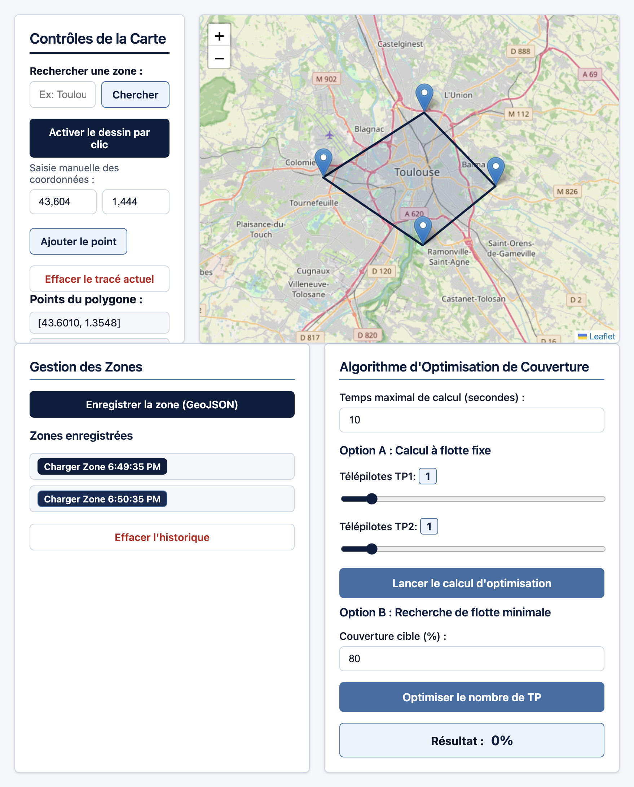
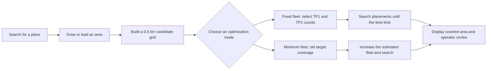
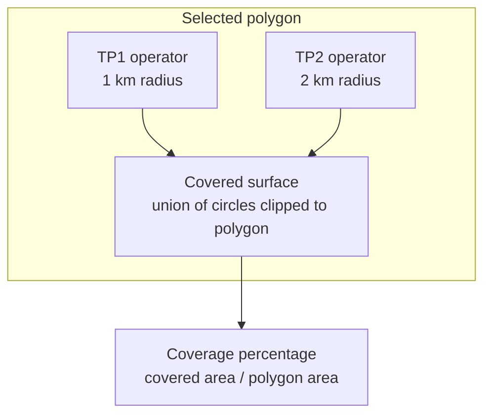

# Drone Coverage Planner

A web application prototype for defining an area on a map and estimating how a team of drone operators could be positioned to cover it.

> The interface shown in the screenshots is currently in French.

## Screenshots

### Define an area on the map

Draw a polygon by clicking on the map, enter coordinates manually, or load a saved GeoJSON zone.



### View a coverage estimate

Run the fixed-fleet optimizer to see candidate operator locations, their coverage radii, and the estimated percentage of the selected area covered. This example uses a six-vertex polygon, 4 TP1 operators, 1 TP2 operator, and a 15-second calculation limit; the displayed result is **79.47%**.


## What the app does

- Displays an interactive Leaflet map, centered on Toulouse by default.
- Finds a place using OpenStreetMap's Nominatim geocoding service.
- Lets users create a polygon by clicking on the map or entering latitude/longitude points.
- Saves, reloads, and clears zones as GeoJSON using the local Vite development server.
- Draws proposed operator locations and their circular coverage areas on the map.
- Provides two optimization modes:
  - **Fixed fleet:** searches for a high-coverage placement for the selected numbers of Level 1 and Level 2 operators.
  - **Minimum fleet:** increases the estimated fleet size until the target coverage is reached, using an 80% Level 1 / 20% Level 2 split.
- Lets users set a time limit for each placement search. When the limit is reached, the optimizer returns the best solution it found so far.

## How it works

The selected polygon is converted to GeoJSON and sampled with a grid of candidate locations. The current grid spacing is **0.5 km**. The optimizer evaluates the union of the selected operators' coverage circles, clips that union to the polygon, and reports the covered area as a percentage of the total area.

The current demonstration uses fixed radii of **1 km for Level 1** and **2 km for Level 2** operators. The candidate grid is shuffled randomly, so results may vary between runs.

### Planning workflow



### Coverage model



## Run locally

Requirements: Node.js and npm.

```bash
npm install
npx vite
```

Open the local URL printed by Vite, usually <http://localhost:5173>.

The starter zones are loaded from [`data/zones.json`](./data/zones.json). Saving or clearing zones sends GeoJSON to a custom route in `vite.config.ts`, which writes to that local file. This is a development-server feature, not a persistent API for a static production deployment.

## Technology

- TypeScript and Vite
- Leaflet and OpenStreetMap map tiles
- Turf.js for grids, polygon operations, and area calculations
- GeoJSON for zone data
- Nominatim for place search

Weather-fetching code for Open-Meteo is present, but the weather widget is not currently included in the page.

## Project layout

| Path | Purpose |
| --- | --- |
| `index.html`, `css/` | Application page and styles |
| `js/app.ts` | Map interactions, saved zones, and optimization UI |
| `js/algo_remplissage.ts` | Fixed-fleet coverage placement optimizer |
| `js/algo_planif.ts` | Minimum-operator estimator for a target coverage |
| `objet/` | GeoJSON, grid, drone, and operator models |
| `data/zones.json` | Starter zones and local development save file |
| `exemple.geojson` | Example GeoJSON area |
| `docs/images/` | README screenshots |

## Limitations and potential improvements

This is a planning and visualization prototype, **not an operational flight-planning or safety tool**. It represents drone capability as a fixed-radius circle and does not model terrain, buildings, obstacles, battery life, airspace restrictions, regulations, or real-world flight safety. Its randomly shuffled candidate grid can also make outcomes inconsistent.

Potential next steps:

1. **Make optimization more predictable:** use a stable or configurable grid, apply one overall time budget to minimum-fleet searches, and report clearly whether a result is optimal, time-limited, or unable to reach the target.
2. **Improve the coverage model:** account for drone endurance, measured sensor range, terrain, obstacles, restricted airspace, weather, and regulatory constraints.
3. **Strengthen area management:** support GeoJSON import/export, per-zone edit and delete actions, and polygon validation before optimization.
4. **Finish the weather experience:** add the missing widget, show forecast timestamps and data sources, and document the operational thresholds.
5. **Prepare for deployment:** replace the development-only file-writing route with a validated API and persistent storage, and display save failures to users.
6. **Improve responsiveness and usability:** move intensive calculations off the UI thread, provide progress and cancellation, and summarize placements and assumptions.
7. **Add project scripts and tests:** provide npm development, build, and test commands, then cover optimizer behavior and geographic edge cases with automated tests.
